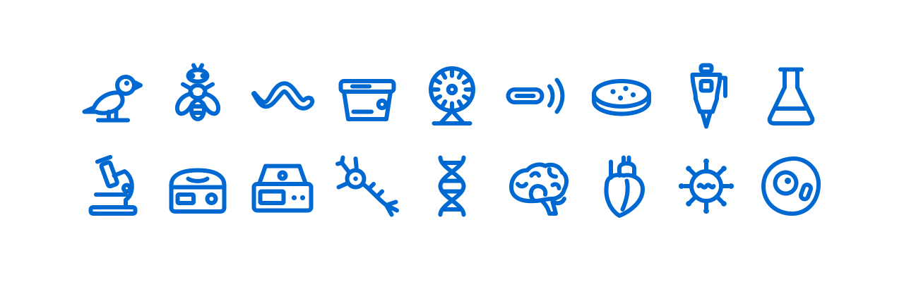

<div align="center">

<a href="https://colony.care"></a>

# lab-icons

Free SVG icons of laboratory animals, anatomical views and lab equipment, for scientific figures, posters and lab software.

[Browse the icons](https://colony.care/en/icons) · [Colony Care](https://colony.care) · [npm](https://www.npmjs.com/package/@colony-care/lab-icons) · [Version française](#français)

[](https://www.npmjs.com/package/@colony-care/lab-icons)
[](LICENSE)
[](https://github.com/Colony-Care/lab-icons/actions/workflows/ci.yml)

<picture>
  <source media="(prefers-color-scheme: dark)" srcset=".github/assets/preview-dark.svg">
  <source media="(prefers-color-scheme: light)" srcset=".github/assets/preview-light.svg">
  
</picture>

<picture>
  <source media="(prefers-color-scheme: dark)" srcset=".github/assets/preview-lab-dark.svg">
  <source media="(prefers-color-scheme: light)" srcset=".github/assets/preview-lab-light.svg">
  
</picture>

</div>

## What's inside

| Species icons | Anatomical views | Lab icons |
| --- | --- | --- |
| 19 icons, 64×64, drawn in `currentColor` | 41 views: dorsal, ventral, lateral, across 22 species | 45 icons in four styles: organisms, vivarium, bench, instruments, organs and cells |

## Use it

### Download

Every icon has its own page on [colony.care/en/icons](https://colony.care/en/icons), with a ready-to-use SVG download.

### npm and React

```bash
npm install @colony-care/lab-icons
```

```tsx
import { MouseIcon } from '@colony-care/lab-icons/react'

<MouseIcon size={32} title="Lab mouse" />
```

The React components cover the 19 species icons and the 45 lab icons. The 41 anatomical views ship as SVG files only.

### Styles

Each lab icon comes in four styles, in its own folder:

| Style | Folder |
| --- | --- |
| Outline | `icons/outline/` |
| Solid | `icons/solid/` |
| Duotone | `icons/duotone/` |
| Inverse | `icons/inverse/` |

In React, pick one with the `variant` prop (default `outline`):

```tsx
import { MicroscopeIcon } from '@colony-care/lab-icons/react'

<MicroscopeIcon variant="solid" />
```

Species icons keep a single style for now. The four styles come to them in a coming release.

### Raw SVG

The SVG files ship in the package, for example `@colony-care/lab-icons/icons/species/mouse.svg` or `@colony-care/lab-icons/icons/solid/microscope.svg`. The full list, with names and tags in English and French, is in `@colony-care/lab-icons/icons.json`.

## Credit

Please credit the icons with this line:

```text
Icons: Colony Care (https://colony.care/en/icons), CC BY 4.0 (https://creativecommons.org/licenses/by/4.0/)
```

In a paper, put it in the figure legend or in the acknowledgements.

## Icon list

<!-- icon-list:start -->

### Species

| Slug | English | Français |
| --- | --- | --- |
| `ant` | Ant | Fourmi |
| `cat` | Cat | Chat |
| `cattle` | Cattle | Bovin |
| `chicken` | Chicken | Poulet |
| `dog` | Dog | Chien |
| `ferret` | Ferret | Furet |
| `frog` | Frog | Grenouille |
| `goat` | Goat | Chèvre |
| `guinea-pig` | Guinea pig | Cobaye |
| `hamster` | Hamster | Hamster |
| `horse` | Horse | Cheval |
| `mouse` | Mouse | Souris |
| `pig` | Pig | Porc |
| `primate` | Non-human primate | Primate non humain |
| `rabbit` | Rabbit | Lapin |
| `rat` | Rat | Rat |
| `sheep` | Sheep | Mouton |
| `turkey` | Turkey | Dindon |
| `zebrafish` | Zebrafish | Poisson-zèbre |

### Anatomical views

| Slug | English | Français |
| --- | --- | --- |
| `capuchin-dorsal` | Capuchin monkey, dorsal view | Capucin, vue dorsale |
| `capuchin-ventral` | Capuchin monkey, ventral view | Capucin, vue ventrale |
| `cat-dorsal` | Cat, dorsal view | Chat, vue dorsale |
| `cat-ventral` | Cat, ventral view | Chat, vue ventrale |
| `cattle-dorsal` | Cattle, dorsal view | Bovin, vue dorsale |
| `chicken-dorsal` | Chicken, dorsal view | Poulet, vue dorsale |
| `chicken-ventral` | Chicken, ventral view | Poulet, vue ventrale |
| `cotton-rat-dorsal` | Cotton rat, dorsal view | Rat du coton, vue dorsale |
| `cotton-rat-ventral` | Cotton rat, ventral view | Rat du coton, vue ventrale |
| `cynomolgus-macaque-dorsal` | Cynomolgus macaque, dorsal view | Macaque crabier, vue dorsale |
| `cynomolgus-macaque-ventral` | Cynomolgus macaque, ventral view | Macaque crabier, vue ventrale |
| `dog-dorsal` | Dog, dorsal view | Chien, vue dorsale |
| `dog-ventral` | Dog, ventral view | Chien, vue ventrale |
| `ferret-dorsal` | Ferret, dorsal view | Furet, vue dorsale |
| `ferret-ventral` | Ferret, ventral view | Furet, vue ventrale |
| `frog-dorsal` | Frog, dorsal view | Grenouille, vue dorsale |
| `frog-ventral` | Frog, ventral view | Grenouille, vue ventrale |
| `goat-dorsal` | Goat, dorsal view | Chèvre, vue dorsale |
| `goat-ventral` | Goat, ventral view | Chèvre, vue ventrale |
| `guinea-pig-dorsal` | Guinea pig, dorsal view | Cobaye, vue dorsale |
| `guinea-pig-ventral` | Guinea pig, ventral view | Cobaye, vue ventrale |
| `hamster-dorsal` | Hamster, dorsal view | Hamster, vue dorsale |
| `hamster-ventral` | Hamster, ventral view | Hamster, vue ventrale |
| `horse-dorsal` | Horse, dorsal view | Cheval, vue dorsale |
| `minipig-dorsal` | Minipig, dorsal view | Miniporc, vue dorsale |
| `minipig-ventral` | Minipig, ventral view | Miniporc, vue ventrale |
| `mouse-dorsal` | Mouse, dorsal view | Souris, vue dorsale |
| `mouse-ventral` | Mouse, ventral view | Souris, vue ventrale |
| `pig-dorsal` | Pig, dorsal view | Porc, vue dorsale |
| `pig-ventral` | Pig, ventral view | Porc, vue ventrale |
| `rabbit-dorsal` | Rabbit, dorsal view | Lapin, vue dorsale |
| `rabbit-ventral` | Rabbit, ventral view | Lapin, vue ventrale |
| `rat-dorsal` | Rat, dorsal view | Rat, vue dorsale |
| `rat-ventral` | Rat, ventral view | Rat, vue ventrale |
| `rhesus-macaque-dorsal` | Rhesus macaque, dorsal view | Macaque rhésus, vue dorsale |
| `rhesus-macaque-ventral` | Rhesus macaque, ventral view | Macaque rhésus, vue ventrale |
| `sheep-dorsal` | Sheep, dorsal view | Mouton, vue dorsale |
| `sheep-ventral` | Sheep, ventral view | Mouton, vue ventrale |
| `turkey-dorsal` | Turkey, dorsal view | Dindon, vue dorsale |
| `turkey-ventral` | Turkey, ventral view | Dindon, vue ventrale |
| `zebrafish-lateral` | Zebrafish, lateral view | Poisson-zèbre, vue latérale |

### Model organisms

| Slug | English | Français | Styles |
| --- | --- | --- | --- |
| `arabidopsis` | Arabidopsis | Arabidopsis | outline, solid, duotone, inverse |
| `c-elegans` | C. elegans | C. elegans | outline, solid, duotone, inverse |
| `drosophila` | Fruit fly | Drosophile | outline, solid, duotone, inverse |
| `e-coli` | E. coli | Bactérie E. coli | outline, solid, duotone, inverse |
| `marmoset` | Marmoset | Ouistiti | outline, solid, duotone, inverse |
| `medaka` | Medaka | Médaka | outline, solid, duotone, inverse |
| `xenopus` | Xenopus | Xénope | outline, solid, duotone, inverse |
| `yeast` | Yeast | Levure | outline, solid, duotone, inverse |
| `zebra-finch` | Zebra finch | Diamant mandarin | outline, solid, duotone, inverse |

### Vivarium

| Slug | English | Français | Styles |
| --- | --- | --- | --- |
| `cage-card` | Cage card | Carte de cage | outline, solid, duotone, inverse |
| `ivc-cage` | IVC cage | Cage ventilée (IVC) | outline, solid, duotone, inverse |
| `nest-house` | Nest house | Maisonnette | outline, solid, duotone, inverse |
| `rat-cage` | Rat cage | Cage rat | outline, solid, duotone, inverse |
| `rfid-tag` | RFID chip | Puce RFID | outline, solid, duotone, inverse |
| `running-wheel` | Running wheel | Roue d’exercice | outline, solid, duotone, inverse |
| `ventilated-rack` | Ventilated rack | Rack ventilé | outline, solid, duotone, inverse |
| `water-bottle` | Water bottle | Biberon | outline, solid, duotone, inverse |
| `zebrafish-rack` | Zebrafish rack | Rack poisson-zèbre | outline, solid, duotone, inverse |

### Bench equipment

| Slug | English | Français | Styles |
| --- | --- | --- | --- |
| `beaker` | Beaker | Bécher | outline, solid, duotone, inverse |
| `conical-tube` | Conical tube | Tube Falcon | outline, solid, duotone, inverse |
| `culture-flask` | Culture flask | Flasque de culture | outline, solid, duotone, inverse |
| `erlenmeyer` | Erlenmeyer flask | Erlenmeyer | outline, solid, duotone, inverse |
| `micropipette` | Micropipette | Micropipette | outline, solid, duotone, inverse |
| `microtube` | Microtube | Tube Eppendorf | outline, solid, duotone, inverse |
| `petri-dish` | Petri dish | Boîte de Petri | outline, solid, duotone, inverse |
| `syringe` | Syringe | Seringue | outline, solid, duotone, inverse |
| `test-tube` | Test tube | Tube à essai | outline, solid, duotone, inverse |
| `well-plate` | 96-well plate | Plaque 96 puits | outline, solid, duotone, inverse |

### Instruments

| Slug | English | Français | Styles |
| --- | --- | --- | --- |
| `biosafety-cabinet` | Biosafety cabinet | Poste de sécurité microbiologique | outline, solid, duotone, inverse |
| `centrifuge` | Centrifuge | Centrifugeuse | outline, solid, duotone, inverse |
| `co2-incubator` | CO2 incubator | Incubateur CO₂ | outline, solid, duotone, inverse |
| `microscope` | Microscope | Microscope | outline, solid, duotone, inverse |
| `thermocycler` | PCR thermocycler | Thermocycleur PCR | outline, solid, duotone, inverse |
| `ult-freezer` | −80 °C freezer | Congélateur −80 °C | outline, solid, duotone, inverse |
| `vortex` | Vortex mixer | Vortex | outline, solid, duotone, inverse |

### Organs and cells

| Slug | English | Français | Styles |
| --- | --- | --- | --- |
| `antibody` | Antibody | Anticorps | outline, solid, duotone, inverse |
| `brain` | Brain | Cerveau | outline, solid, duotone, inverse |
| `cell` | Cell | Cellule | outline, solid, duotone, inverse |
| `dna` | DNA | ADN | outline, solid, duotone, inverse |
| `heart` | Heart | Cœur | outline, solid, duotone, inverse |
| `kidney` | Kidney | Rein | outline, solid, duotone, inverse |
| `liver` | Liver | Foie | outline, solid, duotone, inverse |
| `lungs` | Lungs | Poumons | outline, solid, duotone, inverse |
| `neuron` | Neuron | Neurone | outline, solid, duotone, inverse |
| `virus` | Virus | Virus | outline, solid, duotone, inverse |

<!-- icon-list:end -->

## Licence

The artwork is licensed under CC BY 4.0 (see `LICENSE`). The code is licensed under MIT (see `LICENSE-CODE`).

## About Colony Care

Colony Care is lab animal colony management software for research facilities, built in Québec, Canada. Learn more at [colony.care](https://colony.care), or write to [contact@colony.care](mailto:contact@colony.care).

## Français

### Contenu

| Icônes d’espèces | Vues anatomiques | Icônes de laboratoire |
| --- | --- | --- |
| 19 icônes, 64×64, dessinées en `currentColor` | 41 vues : dorsale, ventrale, latérale, pour 22 espèces | 45 icônes en quatre styles : organismes, animalerie, paillasse, instruments, organes et cellules |

### Utilisation

**Téléchargement.** Chaque icône a sa propre page sur [colony.care/fr-ca/icons](https://colony.care/fr-ca/icons), avec un SVG prêt à l’emploi.

**npm et React.** Installez le paquet :

```bash
npm install @colony-care/lab-icons
```

Puis importez l’icône voulue :

```tsx
import { MouseIcon } from '@colony-care/lab-icons/react'

<MouseIcon size={32} title="Souris de laboratoire" />
```

Les composants React couvrent les 19 icônes d’espèces et les 45 icônes de laboratoire. Les 41 vues anatomiques sont fournies uniquement en fichiers SVG.

**Styles.** Chaque icône de laboratoire existe en quatre styles, dans son propre dossier : `icons/outline/` (contour), `icons/solid/` (plein), `icons/duotone/` (bicolore) et `icons/inverse/` (inversé). En React, choisissez-en un avec la propriété `variant` (contour par défaut) :

```tsx
import { MicroscopeIcon } from '@colony-care/lab-icons/react'

<MicroscopeIcon variant="solid" />
```

Les icônes d’espèces n’ont qu’un seul style pour l’instant. Les quatre styles leur seront offerts dans une prochaine version.

**SVG brut.** Les fichiers SVG sont inclus dans le paquet, par exemple `@colony-care/lab-icons/icons/species/mouse.svg` ou `@colony-care/lab-icons/icons/solid/microscope.svg`. La liste complète, avec les noms et les mots-clés en français et en anglais, se trouve dans `@colony-care/lab-icons/icons.json`.

### Mention de source

Merci de citer les icônes avec cette ligne :

```text
Icônes : Colony Care (https://colony.care/fr-ca/icons), CC BY 4.0 (https://creativecommons.org/licenses/by/4.0/)
```

Dans un article scientifique, placez-la dans la légende de la figure ou dans les remerciements.

### Liste des icônes

<!-- icon-list-fr:start -->

#### Espèces

| Identifiant | English | Français |
| --- | --- | --- |
| `ant` | Ant | Fourmi |
| `cat` | Cat | Chat |
| `cattle` | Cattle | Bovin |
| `chicken` | Chicken | Poulet |
| `dog` | Dog | Chien |
| `ferret` | Ferret | Furet |
| `frog` | Frog | Grenouille |
| `goat` | Goat | Chèvre |
| `guinea-pig` | Guinea pig | Cobaye |
| `hamster` | Hamster | Hamster |
| `horse` | Horse | Cheval |
| `mouse` | Mouse | Souris |
| `pig` | Pig | Porc |
| `primate` | Non-human primate | Primate non humain |
| `rabbit` | Rabbit | Lapin |
| `rat` | Rat | Rat |
| `sheep` | Sheep | Mouton |
| `turkey` | Turkey | Dindon |
| `zebrafish` | Zebrafish | Poisson-zèbre |

#### Vues anatomiques

| Identifiant | English | Français |
| --- | --- | --- |
| `capuchin-dorsal` | Capuchin monkey, dorsal view | Capucin, vue dorsale |
| `capuchin-ventral` | Capuchin monkey, ventral view | Capucin, vue ventrale |
| `cat-dorsal` | Cat, dorsal view | Chat, vue dorsale |
| `cat-ventral` | Cat, ventral view | Chat, vue ventrale |
| `cattle-dorsal` | Cattle, dorsal view | Bovin, vue dorsale |
| `chicken-dorsal` | Chicken, dorsal view | Poulet, vue dorsale |
| `chicken-ventral` | Chicken, ventral view | Poulet, vue ventrale |
| `cotton-rat-dorsal` | Cotton rat, dorsal view | Rat du coton, vue dorsale |
| `cotton-rat-ventral` | Cotton rat, ventral view | Rat du coton, vue ventrale |
| `cynomolgus-macaque-dorsal` | Cynomolgus macaque, dorsal view | Macaque crabier, vue dorsale |
| `cynomolgus-macaque-ventral` | Cynomolgus macaque, ventral view | Macaque crabier, vue ventrale |
| `dog-dorsal` | Dog, dorsal view | Chien, vue dorsale |
| `dog-ventral` | Dog, ventral view | Chien, vue ventrale |
| `ferret-dorsal` | Ferret, dorsal view | Furet, vue dorsale |
| `ferret-ventral` | Ferret, ventral view | Furet, vue ventrale |
| `frog-dorsal` | Frog, dorsal view | Grenouille, vue dorsale |
| `frog-ventral` | Frog, ventral view | Grenouille, vue ventrale |
| `goat-dorsal` | Goat, dorsal view | Chèvre, vue dorsale |
| `goat-ventral` | Goat, ventral view | Chèvre, vue ventrale |
| `guinea-pig-dorsal` | Guinea pig, dorsal view | Cobaye, vue dorsale |
| `guinea-pig-ventral` | Guinea pig, ventral view | Cobaye, vue ventrale |
| `hamster-dorsal` | Hamster, dorsal view | Hamster, vue dorsale |
| `hamster-ventral` | Hamster, ventral view | Hamster, vue ventrale |
| `horse-dorsal` | Horse, dorsal view | Cheval, vue dorsale |
| `minipig-dorsal` | Minipig, dorsal view | Miniporc, vue dorsale |
| `minipig-ventral` | Minipig, ventral view | Miniporc, vue ventrale |
| `mouse-dorsal` | Mouse, dorsal view | Souris, vue dorsale |
| `mouse-ventral` | Mouse, ventral view | Souris, vue ventrale |
| `pig-dorsal` | Pig, dorsal view | Porc, vue dorsale |
| `pig-ventral` | Pig, ventral view | Porc, vue ventrale |
| `rabbit-dorsal` | Rabbit, dorsal view | Lapin, vue dorsale |
| `rabbit-ventral` | Rabbit, ventral view | Lapin, vue ventrale |
| `rat-dorsal` | Rat, dorsal view | Rat, vue dorsale |
| `rat-ventral` | Rat, ventral view | Rat, vue ventrale |
| `rhesus-macaque-dorsal` | Rhesus macaque, dorsal view | Macaque rhésus, vue dorsale |
| `rhesus-macaque-ventral` | Rhesus macaque, ventral view | Macaque rhésus, vue ventrale |
| `sheep-dorsal` | Sheep, dorsal view | Mouton, vue dorsale |
| `sheep-ventral` | Sheep, ventral view | Mouton, vue ventrale |
| `turkey-dorsal` | Turkey, dorsal view | Dindon, vue dorsale |
| `turkey-ventral` | Turkey, ventral view | Dindon, vue ventrale |
| `zebrafish-lateral` | Zebrafish, lateral view | Poisson-zèbre, vue latérale |

#### Organismes modèles

| Identifiant | English | Français | Styles |
| --- | --- | --- | --- |
| `arabidopsis` | Arabidopsis | Arabidopsis | outline, solid, duotone, inverse |
| `c-elegans` | C. elegans | C. elegans | outline, solid, duotone, inverse |
| `drosophila` | Fruit fly | Drosophile | outline, solid, duotone, inverse |
| `e-coli` | E. coli | Bactérie E. coli | outline, solid, duotone, inverse |
| `marmoset` | Marmoset | Ouistiti | outline, solid, duotone, inverse |
| `medaka` | Medaka | Médaka | outline, solid, duotone, inverse |
| `xenopus` | Xenopus | Xénope | outline, solid, duotone, inverse |
| `yeast` | Yeast | Levure | outline, solid, duotone, inverse |
| `zebra-finch` | Zebra finch | Diamant mandarin | outline, solid, duotone, inverse |

#### Animalerie

| Identifiant | English | Français | Styles |
| --- | --- | --- | --- |
| `cage-card` | Cage card | Carte de cage | outline, solid, duotone, inverse |
| `ivc-cage` | IVC cage | Cage ventilée (IVC) | outline, solid, duotone, inverse |
| `nest-house` | Nest house | Maisonnette | outline, solid, duotone, inverse |
| `rat-cage` | Rat cage | Cage rat | outline, solid, duotone, inverse |
| `rfid-tag` | RFID chip | Puce RFID | outline, solid, duotone, inverse |
| `running-wheel` | Running wheel | Roue d’exercice | outline, solid, duotone, inverse |
| `ventilated-rack` | Ventilated rack | Rack ventilé | outline, solid, duotone, inverse |
| `water-bottle` | Water bottle | Biberon | outline, solid, duotone, inverse |
| `zebrafish-rack` | Zebrafish rack | Rack poisson-zèbre | outline, solid, duotone, inverse |

#### Matériel de paillasse

| Identifiant | English | Français | Styles |
| --- | --- | --- | --- |
| `beaker` | Beaker | Bécher | outline, solid, duotone, inverse |
| `conical-tube` | Conical tube | Tube Falcon | outline, solid, duotone, inverse |
| `culture-flask` | Culture flask | Flasque de culture | outline, solid, duotone, inverse |
| `erlenmeyer` | Erlenmeyer flask | Erlenmeyer | outline, solid, duotone, inverse |
| `micropipette` | Micropipette | Micropipette | outline, solid, duotone, inverse |
| `microtube` | Microtube | Tube Eppendorf | outline, solid, duotone, inverse |
| `petri-dish` | Petri dish | Boîte de Petri | outline, solid, duotone, inverse |
| `syringe` | Syringe | Seringue | outline, solid, duotone, inverse |
| `test-tube` | Test tube | Tube à essai | outline, solid, duotone, inverse |
| `well-plate` | 96-well plate | Plaque 96 puits | outline, solid, duotone, inverse |

#### Instruments

| Identifiant | English | Français | Styles |
| --- | --- | --- | --- |
| `biosafety-cabinet` | Biosafety cabinet | Poste de sécurité microbiologique | outline, solid, duotone, inverse |
| `centrifuge` | Centrifuge | Centrifugeuse | outline, solid, duotone, inverse |
| `co2-incubator` | CO2 incubator | Incubateur CO₂ | outline, solid, duotone, inverse |
| `microscope` | Microscope | Microscope | outline, solid, duotone, inverse |
| `thermocycler` | PCR thermocycler | Thermocycleur PCR | outline, solid, duotone, inverse |
| `ult-freezer` | −80 °C freezer | Congélateur −80 °C | outline, solid, duotone, inverse |
| `vortex` | Vortex mixer | Vortex | outline, solid, duotone, inverse |

#### Organes et cellules

| Identifiant | English | Français | Styles |
| --- | --- | --- | --- |
| `antibody` | Antibody | Anticorps | outline, solid, duotone, inverse |
| `brain` | Brain | Cerveau | outline, solid, duotone, inverse |
| `cell` | Cell | Cellule | outline, solid, duotone, inverse |
| `dna` | DNA | ADN | outline, solid, duotone, inverse |
| `heart` | Heart | Cœur | outline, solid, duotone, inverse |
| `kidney` | Kidney | Rein | outline, solid, duotone, inverse |
| `liver` | Liver | Foie | outline, solid, duotone, inverse |
| `lungs` | Lungs | Poumons | outline, solid, duotone, inverse |
| `neuron` | Neuron | Neurone | outline, solid, duotone, inverse |
| `virus` | Virus | Virus | outline, solid, duotone, inverse |

<!-- icon-list-fr:end -->

### Licence

Les illustrations sont sous licence CC BY 4.0 (voir `LICENSE`). Le code est sous licence MIT (voir `LICENSE-CODE`).

### À propos de Colony Care

Colony Care est un logiciel de gestion de colonies d’animaux de laboratoire pour les établissements de recherche, conçu au Québec, au Canada. Pour en savoir plus, visitez [colony.care](https://colony.care/fr-ca) ou écrivez à [contact@colony.care](mailto:contact@colony.care).
