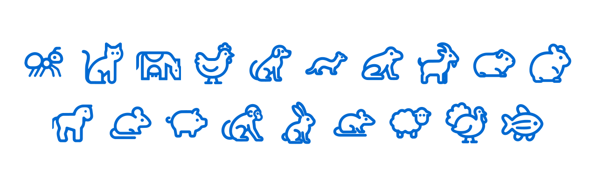

<div align="center">

<a href="https://colony.care"></a>

# lab-icons

Free SVG icons of laboratory animals and anatomical views, for scientific figures, posters and lab software.

[Browse the icons](https://colony.care/en/icons) · [Colony Care](https://colony.care) · [npm](https://www.npmjs.com/package/@colony-care/lab-icons) · [Version française](#français)

[](https://www.npmjs.com/package/@colony-care/lab-icons)
[](LICENSE)
[](https://github.com/Colony-Care/lab-icons/actions/workflows/ci.yml)

<picture>
  <source media="(prefers-color-scheme: dark)" srcset=".github/assets/preview-dark.svg">
  <source media="(prefers-color-scheme: light)" srcset=".github/assets/preview-light.svg">
  
</picture>

</div>

## What's inside

| Species icons | Anatomical views |
| --- | --- |
| 19 icons, 64×64, drawn in `currentColor` | 41 views: dorsal, ventral, lateral, across 22 species |

## Use it

### Download

Every icon has its own page on [colony.care/en/icons](https://colony.care/en/icons), with a ready-to-use SVG download.

### npm and React

```bash
npm install @colony-care/lab-icons
```

```tsx
import { MouseIcon } from '@colony-care/lab-icons/react'

<MouseIcon size={32} title="Lab mouse" />
```

The React components cover the 19 species icons. The 41 anatomical views ship as SVG files only.

### Raw SVG

The SVG files ship in the package, for example `@colony-care/lab-icons/icons/species/mouse.svg`. The full list, with names and tags in English and French, is in `@colony-care/lab-icons/icons.json`.

## Credit

Please credit the icons with this line:

```text
Icons: Colony Care (https://colony.care/en/icons), CC BY 4.0 (https://creativecommons.org/licenses/by/4.0/)
```

In a paper, put it in the figure legend or in the acknowledgements.

## Icon list

<!-- icon-list:start -->

| Slug | English | Français |
| --- | --- | --- |
| `ant` | Ant | Fourmi |
| `cat` | Cat | Chat |
| `cattle` | Cattle | Bovin |
| `chicken` | Chicken | Poulet |
| `dog` | Dog | Chien |
| `ferret` | Ferret | Furet |
| `frog` | Frog | Grenouille |
| `goat` | Goat | Chèvre |
| `guinea-pig` | Guinea pig | Cobaye |
| `hamster` | Hamster | Hamster |
| `horse` | Horse | Cheval |
| `mouse` | Mouse | Souris |
| `pig` | Pig | Porc |
| `primate` | Non-human primate | Primate non humain |
| `rabbit` | Rabbit | Lapin |
| `rat` | Rat | Rat |
| `sheep` | Sheep | Mouton |
| `turkey` | Turkey | Dindon |
| `zebrafish` | Zebrafish | Poisson-zèbre |
| `capuchin-dorsal` | Capuchin monkey, dorsal view | Capucin, vue dorsale |
| `capuchin-ventral` | Capuchin monkey, ventral view | Capucin, vue ventrale |
| `cat-dorsal` | Cat, dorsal view | Chat, vue dorsale |
| `cat-ventral` | Cat, ventral view | Chat, vue ventrale |
| `cattle-dorsal` | Cattle, dorsal view | Bovin, vue dorsale |
| `chicken-dorsal` | Chicken, dorsal view | Poulet, vue dorsale |
| `chicken-ventral` | Chicken, ventral view | Poulet, vue ventrale |
| `cotton-rat-dorsal` | Cotton rat, dorsal view | Rat du coton, vue dorsale |
| `cotton-rat-ventral` | Cotton rat, ventral view | Rat du coton, vue ventrale |
| `cynomolgus-macaque-dorsal` | Cynomolgus macaque, dorsal view | Macaque crabier, vue dorsale |
| `cynomolgus-macaque-ventral` | Cynomolgus macaque, ventral view | Macaque crabier, vue ventrale |
| `dog-dorsal` | Dog, dorsal view | Chien, vue dorsale |
| `dog-ventral` | Dog, ventral view | Chien, vue ventrale |
| `ferret-dorsal` | Ferret, dorsal view | Furet, vue dorsale |
| `ferret-ventral` | Ferret, ventral view | Furet, vue ventrale |
| `frog-dorsal` | Frog, dorsal view | Grenouille, vue dorsale |
| `frog-ventral` | Frog, ventral view | Grenouille, vue ventrale |
| `goat-dorsal` | Goat, dorsal view | Chèvre, vue dorsale |
| `goat-ventral` | Goat, ventral view | Chèvre, vue ventrale |
| `guinea-pig-dorsal` | Guinea pig, dorsal view | Cobaye, vue dorsale |
| `guinea-pig-ventral` | Guinea pig, ventral view | Cobaye, vue ventrale |
| `hamster-dorsal` | Hamster, dorsal view | Hamster, vue dorsale |
| `hamster-ventral` | Hamster, ventral view | Hamster, vue ventrale |
| `horse-dorsal` | Horse, dorsal view | Cheval, vue dorsale |
| `minipig-dorsal` | Minipig, dorsal view | Miniporc, vue dorsale |
| `minipig-ventral` | Minipig, ventral view | Miniporc, vue ventrale |
| `mouse-dorsal` | Mouse, dorsal view | Souris, vue dorsale |
| `mouse-ventral` | Mouse, ventral view | Souris, vue ventrale |
| `pig-dorsal` | Pig, dorsal view | Porc, vue dorsale |
| `pig-ventral` | Pig, ventral view | Porc, vue ventrale |
| `rabbit-dorsal` | Rabbit, dorsal view | Lapin, vue dorsale |
| `rabbit-ventral` | Rabbit, ventral view | Lapin, vue ventrale |
| `rat-dorsal` | Rat, dorsal view | Rat, vue dorsale |
| `rat-ventral` | Rat, ventral view | Rat, vue ventrale |
| `rhesus-macaque-dorsal` | Rhesus macaque, dorsal view | Macaque rhésus, vue dorsale |
| `rhesus-macaque-ventral` | Rhesus macaque, ventral view | Macaque rhésus, vue ventrale |
| `sheep-dorsal` | Sheep, dorsal view | Mouton, vue dorsale |
| `sheep-ventral` | Sheep, ventral view | Mouton, vue ventrale |
| `turkey-dorsal` | Turkey, dorsal view | Dindon, vue dorsale |
| `turkey-ventral` | Turkey, ventral view | Dindon, vue ventrale |
| `zebrafish-lateral` | Zebrafish, lateral view | Poisson-zèbre, vue latérale |

<!-- icon-list:end -->

## Licence

The artwork is licensed under CC BY 4.0 (see `LICENSE`). The code is licensed under MIT (see `LICENSE-CODE`).

## About Colony Care

Colony Care is lab animal colony management software for research facilities, built in Québec, Canada. Learn more at [colony.care](https://colony.care), or write to [contact@colony.care](mailto:contact@colony.care).

## Français

### Contenu

| Icônes d’espèces | Vues anatomiques |
| --- | --- |
| 19 icônes, 64×64, dessinées en `currentColor` | 41 vues : dorsale, ventrale, latérale, pour 22 espèces |

### Utilisation

**Téléchargement.** Chaque icône a sa propre page sur [colony.care/fr-ca/icons](https://colony.care/fr-ca/icons), avec un SVG prêt à l’emploi.

**npm et React.** Installez le paquet :

```bash
npm install @colony-care/lab-icons
```

Puis importez l’icône voulue :

```tsx
import { MouseIcon } from '@colony-care/lab-icons/react'

<MouseIcon size={32} title="Souris de laboratoire" />
```

Les composants React couvrent les 19 icônes d’espèces. Les 41 vues anatomiques sont fournies uniquement en fichiers SVG.

**SVG brut.** Les fichiers SVG sont inclus dans le paquet, par exemple `@colony-care/lab-icons/icons/species/mouse.svg`. La liste complète, avec les noms et les mots-clés en français et en anglais, se trouve dans `@colony-care/lab-icons/icons.json`.

### Mention de source

Merci de citer les icônes avec cette ligne :

```text
Icônes : Colony Care (https://colony.care/fr-ca/icons), CC BY 4.0 (https://creativecommons.org/licenses/by/4.0/)
```

Dans un article scientifique, placez-la dans la légende de la figure ou dans les remerciements.

### Liste des icônes

La liste complète des 60 icônes, avec leurs noms en français et en anglais, figure dans la section [« Icon list »](#icon-list) plus haut.

### Licence

Les illustrations sont sous licence CC BY 4.0 (voir `LICENSE`). Le code est sous licence MIT (voir `LICENSE-CODE`).

### À propos de Colony Care

Colony Care est un logiciel de gestion de colonies d’animaux de laboratoire pour les établissements de recherche, conçu au Québec, au Canada. Pour en savoir plus, visitez [colony.care](https://colony.care/fr-ca) ou écrivez à [contact@colony.care](mailto:contact@colony.care).
